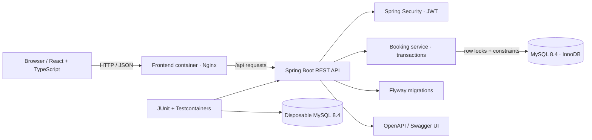

<div align="center">


### A cinematic full-stack movie booking experience

[](https://github.com/Sai-Srinivas-P/DIGITAL-MOVIE-TICKET-PORTAL/actions/workflows/ci.yml)


**Discover a film. Choose a showtime. Lock your seats. Enjoy the show.**

[Quick Start](#-quick-start-recommended) · [Features](#-features) · [Architecture](#-architecture) · [Testing](#-testing) · [API Docs](#-application-urls)

</div>

---

## 🍿 Table of Contents

- [Project Overview](#-project-overview)
- [Animated UI Showcase](#-animated-ui-showcase)
- [Features](#-features)
- [Technology Stack](#-technology-stack)
- [Architecture](#-architecture)
- [Prerequisites](#-prerequisites)
- [Quick Start (Recommended)](#-quick-start-recommended)
- [Application URLs](#-application-urls)
- [How to Use the Portal](#-how-to-use-the-portal)
- [Run Without Docker](#-run-without-docker)
- [Environment Configuration](#-environment-configuration)
- [Testing](#-testing)
- [Project Structure](#-project-structure)
- [Troubleshooting](#-troubleshooting)
- [Security and Demo Limitations](#-security-and-demo-limitations)
- [Roadmap](#-roadmap)
- [License](#-license)

## 🎞️ Project Overview

**Digital Movie Ticket Portal** is a portfolio-focused, full-stack cinema booking application. Its frontend is a React single-page application; the REST API is built with Java and Spring Boot; MySQL stores users, movies, showtimes, seats, holds, and bookings.

The main engineering focus is **concurrency-safe seat booking**. Seat availability is enforced by the backend and database, not trusted to the browser. The booking service uses transactional row locks, expiring holds, and database constraints so concurrent requests cannot successfully claim the same seat.

> **Project scope:** this is a runnable demo/portfolio MVP. Checkout confirms a demo reservation and does **not** process or charge a real payment.

## 🎥 Animated UI Showcase

The theater marquee above animates its lights and title. This gallery moves **from left to right** through the main states already present in the Luma React application.



<sub>The gallery is an illustrative UI-flow preview, not a live capture. Ticket codes, seat selections, and totals shown in the gallery are examples, not real bookings.</sub>

## ✨ Features

| Area | What is included |
|---|---|
| 🎬 Movie discovery | Browse a seeded catalogue of demo films. |
| 🗓️ Showtimes | Choose upcoming showtimes at the demo cinema. A rolling seeder fills missing showtimes through the next 14 days when the backend starts. |
| 💺 Seat map | See available, selected, held, and booked seats with price tiers; select up to eight seats in one hold. |
| 🔐 Authentication | Register and sign in with email/password; the API returns a JWT for protected actions. Passwords are hashed server-side. |
| ⏳ Temporary holds | Hold selected seats for five minutes or release the hold early. Expired holds can be reclaimed. |
| 🧾 Booking confirmation | Confirm a valid hold and receive a booking code, showtime, selected seats, and total. |
| 🎟️ My Tickets | View booking history for the currently authenticated user. |
| 🔒 Concurrency protection | Pessimistic database row locks within transactions, plus uniqueness constraints, protect seats under simultaneous requests. |
| 🗃️ Schema migrations | Flyway manages versioned MySQL schema and initial sample data. Hibernate validates the schema on startup. |
| 📘 API documentation | OpenAPI/Swagger UI documents the REST API. |
| 🐳 Local environment | Docker Compose starts MySQL, the Spring Boot API, and the built frontend. |
| 🧪 Automated checks | JUnit 5, Spring Boot Test, Mockito, and a MySQL Testcontainers concurrency/schedule test. |
| ⚙️ Continuous integration | GitHub Actions verifies the backend and builds the frontend on pushes and pull requests. |

## 🧰 Technology Stack

| Layer | Technology |
|---|---|
| Language/runtime | Java 21 |
| Backend | Spring Boot 4.1.1, Spring Web MVC, Spring Security, JWT, Spring Data JPA, Hibernate |
| Database | MySQL 8.4 with InnoDB |
| Database migrations | Flyway |
| API docs | springdoc OpenAPI / Swagger UI |
| Frontend | React 19, TypeScript 5.9, Vite 7, Tailwind CSS 4 |
| Tests | JUnit 5, Mockito, Spring Boot Test, Testcontainers |
| Containers | Docker, Docker Compose, Nginx for the frontend image |
| CI | GitHub Actions |

## 🏗️ Architecture



**Seat booking flow**

1. The browser requests the seat map from the API.
2. A user selects seats and requests a hold.
3. The API locks the requested seat rows in a database transaction and verifies availability.
4. On success, a five-minute hold token is returned. The backend remains the source of truth.
5. The user confirms before expiry. The transaction creates a booking, links the booking seats, and marks the seats booked.
6. Any competing request for those same seats is rejected; unique constraints provide an additional integrity guard.

## ✅ Prerequisites

### For the recommended Docker setup

Install:

1. **Git** (to clone the repository).
2. **Docker Desktop** with Docker Compose enabled. Start Docker Desktop before running the commands.
3. A terminal such as PowerShell, Windows Terminal, macOS Terminal, or a Linux shell.

You do **not** need to install Java, Maven, Node.js, or MySQL separately when running the full stack through Docker Compose.

### For running services directly on your computer

Install:

- Java **21 JDK** (not just a JRE).
- Node.js **22** with npm.
- MySQL **8.4** (or start just the MySQL service using Docker Compose).
- Git.

Official downloads: [Eclipse Temurin JDK 21](https://adoptium.net/temurin/releases/?version=21) · [Node.js](https://nodejs.org/en/download) · [Docker Desktop](https://www.docker.com/products/docker-desktop/) · [Git](https://git-scm.com/downloads)

## 🚀 Quick Start (Recommended)

These commands are for **Windows PowerShell**. The equivalent Docker commands also work in macOS/Linux terminals.

### 1. Clone the repository

```powershell
git clone https://github.com/Sai-Srinivas-P/DIGITAL-MOVIE-TICKET-PORTAL.git
cd DIGITAL-MOVIE-TICKET-PORTAL
```

### 2. Create your local environment file

```powershell
if (-not (Test-Path .env)) {
    Copy-Item .env.example .env
} else {
    Write-Host ".env already exists; keeping your current settings."
}
```

The example values are for local development only. Read [Environment Configuration](#-environment-configuration) before using the project in a shared or deployed environment.

### 3. Build and start the full stack

```powershell
docker compose up --build -d
```

First startup can take a few minutes while Docker downloads images and builds the backend/frontend. The backend waits for MySQL to become healthy and then runs Flyway migrations.

### 4. Check container status and logs

```powershell
docker compose ps
docker compose logs -f backend
```

Wait for the backend to finish starting. To stop following logs, press `Ctrl+C`; this does not stop the containers.

### 5. Open the portal

Go to [http://localhost:8080](http://localhost:8080).

## 🌐 Application URLs

| Service | URL | Purpose |
|---|---|---|
| **Movie portal** | [http://localhost:8080](http://localhost:8080) | Main React application |
| **Backend health** | [http://localhost:8081/actuator/health](http://localhost:8081/actuator/health) | Health check; a healthy response should report `UP` |
| **Swagger UI** | [http://localhost:8081/swagger-ui.html](http://localhost:8081/swagger-ui.html) | Explore and try the REST API |
| OpenAPI JSON | [http://localhost:8081/v3/api-docs](http://localhost:8081/v3/api-docs) | Machine-readable API specification |
| MySQL (local only) | `localhost:3306` | Database connection for local development tools |

The Compose file binds published ports to `127.0.0.1`, so these services are intended for local use by default.

### Useful Docker commands

```powershell
# Show running services
docker compose ps

# Follow all service logs
docker compose logs -f

# Restart services after changing configuration
docker compose up --build -d

# Stop services; keep database data
docker compose down
```

To **delete the local database and all data**, run `docker compose down -v`. This is destructive and is not needed for normal restarts.

## 🎫 How to Use the Portal

1. Open the movie portal and browse the sample catalogue.
2. Choose **Find a showtime** on a film and select a showtime.
3. Select up to eight available seats on the seat map.
4. Click **Hold seats**. Sign in or create an account if prompted.
5. The API holds the seats for five minutes. Click **Confirm booking** before the countdown expires, or release the hold to make the seats available again.
6. Open **My tickets** to review the confirmed ticket and booking code.
7. To verify account privacy and seat integrity, open a private browser window and use a second account. Confirmed seats should be unavailable to the second account, and booking history should remain user-specific.

**Demo payment note:** the confirmation flow is simulated. No card details are requested and no payment is processed.

## 🖥️ Run Without Docker

Use this section if you want to run the Java API and React development server directly on your machine. You still need MySQL 8.4 running locally, either installed on Windows or started through Compose.

### 1. Start MySQL

An easy option is to start only the database container from the project root:

```powershell
docker compose up -d mysql
```

Wait until this command reports the MySQL service as healthy:

```powershell
docker compose ps
```

The sample `.env` values create the development database `movie_portal` and user `movie_app`. If you changed the passwords in `.env`, use the matching password in the backend environment below.

### 2. Run the backend

Open a terminal in the `backend` directory:

```powershell
cd backend

# Configure the API to connect to the MySQL container on your host.
$env:SERVER_PORT = "8081"
$env:DB_URL = "jdbc:mysql://localhost:3306/movie_portal?useSSL=false&allowPublicKeyRetrieval=true&serverTimezone=UTC"
$env:DB_USERNAME = "movie_app"
$env:DB_PASSWORD = "movie_app_dev_only"
$env:DEMO_SCHEDULE_ENABLED = "true"

# Development-only secret from .env.example. Replace it if you changed JWT_SECRET in .env.
$env:JWT_SECRET = "bXktZGV2ZWxvcG1lbnQtc2VjcmV0LWtleS1mb3ItbW92aWUtcG9ydGFsLTIwMjY="

.\mvnw.cmd -B spring-boot:run
```

The backend runs on `http://localhost:8081`. Flyway creates/updates the schema at startup. Keep this terminal open.

> If you changed `DB_PASSWORD` or `JWT_SECRET` in `.env`, update the matching `$env:` values above. The host PowerShell process does not automatically read variables from `.env`.

### 3. Run the frontend

Open a **second terminal** in the `frontend` directory:

```powershell
cd frontend
npm ci
npm run dev
```

Open the Vite development URL shown in the terminal, normally [http://localhost:5173](http://localhost:5173). The Vite configuration proxies `/api`, `/swagger-ui`, and `/v3/api-docs` to the backend on port `8081`.

### Production-style frontend build

From the `frontend` directory:

```powershell
npm ci
npm run build
```

The compiled static files are written to `frontend/dist/`.

## 🔧 Environment Configuration

The root `.env.example` lists the variables consumed by Docker Compose:

| Variable | Purpose | Development note |
|---|---|---|
| `DB_PASSWORD` | Password for the `movie_app` database user | Must match between MySQL and the API |
| `MYSQL_ROOT_PASSWORD` | MySQL root account password | Local container initialization only |
| `JWT_SECRET` | Signs JWT authentication tokens | Use a newly generated secret outside local development |
| `DEMO_SCHEDULE_ENABLED` | Enables rolling demo showtime generation | `true` for the sample catalogue |

The backend also supports `SERVER_PORT`, `DB_URL`, `DB_USERNAME`, and `JWT_EXPIRATION_MINUTES`.

**Never commit `.env` or real credentials.** `.env` is ignored by Git; commit `.env.example` only. The checked-in defaults are deliberately for local demonstration, not production. For a new secret, generate at least 32 random bytes and Base64-encode them; for example, with Node.js:

```powershell
node -e "console.log(require('crypto').randomBytes(32).toString('base64'))"
```

Copy the generated value into your local `.env` as `JWT_SECRET=...`. Do not paste production credentials into issues, logs, or source code.

## 🧪 Testing

### Backend test suite

Start Docker Desktop first, then run this from the project root:

```powershell
cd backend
.\mvnw.cmd -B verify
```

The Linux/macOS equivalent is:

```bash
cd backend
./mvnw -B verify
```

`verify` compiles the API, compiles the tests, and runs the tests. The Testcontainers integration test starts a disposable MySQL 8.4 container, so Docker must be available. Look for `BUILD SUCCESS` and inspect the test summary for failures or skipped tests.

To print the local test summaries in PowerShell:

```powershell
Get-ChildItem .\target\surefire-reports\*.txt |
    Select-String "Tests run:"
```

The integration tests cover the rolling sample schedule/seat map and a concurrent attempt by two users to hold the same seat. A separate test covers booking validation.

### Frontend build check

```powershell
cd frontend
npm ci
npm run build
```

### GitHub Actions

[View workflow runs](https://github.com/Sai-Srinivas-P/DIGITAL-MOVIE-TICKET-PORTAL/actions). CI uses Java 21 and Node.js 22. It runs backend Maven verification (including MySQL through Testcontainers) and builds the React frontend for each push and pull request.

## 🗂️ Project Structure

```text
DIGITAL-MOVIE-TICKET-PORTAL/
├── .github/
│   └── workflows/
│       └── ci.yml                     # Backend verification + frontend build
├── backend/
│   ├── .mvn/wrapper/                  # Maven Wrapper configuration
│   ├── src/
│   │   ├── main/java/com/portal/movies/
│   │   │   ├── auth/                  # Registration, login, JWT
│   │   │   ├── booking/               # Holds, confirmation, booking history
│   │   │   ├── catalog/               # Movie/showtime API and demo schedule
│   │   │   ├── config/                # Security and OpenAPI configuration
│   │   │   ├── domain/                # JPA entities and seat state
│   │   │   ├── repository/             # Spring Data repositories and seat locks
│   │   │   └── web/                   # API errors and exception handling
│   │   ├── main/resources/
│   │   │   ├── db/migration/           # Versioned Flyway SQL migrations
│   │   │   └── application.properties
│   │   └── test/java/com/portal/movies/
│   │       └── booking/               # MySQL concurrency/schedule + validation tests
│   ├── Dockerfile
│   ├── mvnw / mvnw.cmd
│   └── pom.xml
├── frontend/
│   ├── src/
│   │   ├── App.tsx                    # Discover, seat booking, auth, My Tickets UI
│   │   ├── index.css                  # Theater-inspired responsive styling
│   │   └── main.tsx
│   ├── package.json
│   ├── package-lock.json
│   ├── vite.config.ts
│   └── Dockerfile
├── docs/
│   ├── architecture.md                # Architecture notes
│   └── media/
│       ├── theater-marquee.svg        # Animated theater-style title
│       └── cinema-showcase.svg        # Left-to-right animated UI flow
├── .env.example                       # Safe-to-commit development template
├── compose.yaml                       # MySQL + backend + frontend
└── README.md
```

## 🛠️ Troubleshooting

| Symptom | What to check |
|---|---|
| `docker` command not found | Install Docker Desktop, restart the terminal, and confirm Docker Desktop is running. |
| `JAVA_HOME not found` when running Maven locally | Install a Java 21 **JDK** and configure `JAVA_HOME`, or use the recommended full Docker setup. |
| `./mvnw: Permission denied` in Linux/CI | The repository tracks `backend/mvnw` as executable. If you recreate the file on Windows and lose the mode, restore it with `git update-index --chmod=+x backend/mvnw` and commit the change. |
| Port `8080`, `8081`, or `3306` is already in use | Stop the process using that port or edit the port mapping in `compose.yaml`. |
| Backend exits while MySQL is starting | Run `docker compose ps` and `docker compose logs -f mysql backend`; wait for MySQL's health check and inspect the first backend error. |
| Database authentication fails | Ensure `.env` passwords match the initialized database volume. Changing a MySQL password after the volume was initialized does not automatically rewrite the existing user password. |
| Movie catalogue is empty | Check that Flyway completed, the backend is healthy, and `DEMO_SCHEDULE_ENABLED=true`. |
| Seat becomes unavailable during checkout | Refresh the seat map. A concurrent user may have held or booked it; the API rejects conflicts by design. |

If you deliberately need to reset the local demo database, `docker compose down -v` removes the MySQL volume and all local accounts/bookings. The next start creates a fresh sample database. Do not run it if you want to keep your local data.

## 🔐 Security and Demo Limitations

This repository is intended for local use and technical demonstration.

- Default secrets are development-only; rotate them before sharing an environment.
- The Compose ports bind to localhost by default.
- Checkout is simulated: there is no payment gateway, card handling, or refund workflow.
- There is no admin dashboard for managing movies or showtimes; the sample catalogue is supplied through Flyway and the demo schedule seeder.
- Email notifications and QR-code tickets are not implemented.
- Before any public deployment, add production secret management, rate limiting, deployment-specific CORS/HTTPS configuration, monitoring, and a reviewed authentication/token lifecycle.

## 🧭 Roadmap

Potential future additions, intentionally outside the current MVP:

- Admin screens for films, cinemas, pricing, and showtimes.
- Real payment-provider integration with idempotency and refund flows.
- Downloadable QR ticket and email confirmation.
- Rate limiting, observability, and production deployment.

## 📄 License

This project is distributed under the [MIT License](LICENSE).
